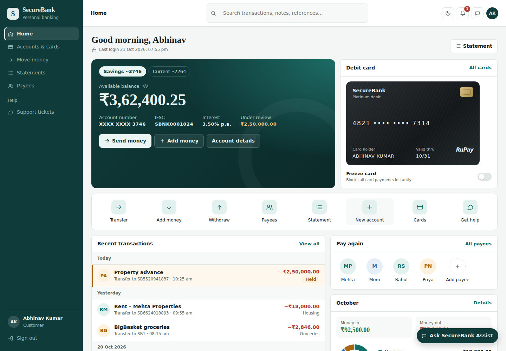
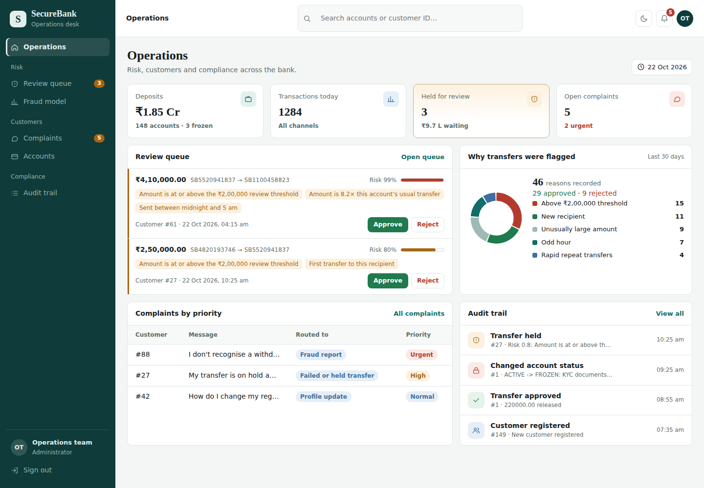

# SecureBank AI

A full-stack banking platform: **Java 17 + Spring Boot** backend, **React** frontend, and AI features
written in plain Java: a fraud-detection model with explainable reason codes, an NLP support-ticket triage,
and a retrieval-based policy assistant.





## Features

**Customers:** register and log in (JWT) · savings and current accounts · debit cards with instant freeze ·
deposits, withdrawals and transfers · saved payees · statements with search · spending insights by category ·
support tickets · SecureBank Assist chat.

**Bank staff (admin):** operations dashboard · review queue for held transfers (approve / reject) ·
fraud model metrics · complaints ranked by urgency · account freeze/close · full audit trail.

## Tech stack
Java 17 · Spring Boot 3 · Spring Data JPA (Hibernate) · MySQL · JWT (jjwt) · BCrypt · Swagger/OpenAPI ·
JUnit 5 + H2 · React 18 + Vite

## Run it

**Backend**
1. Start MySQL (the `securebank` database is created automatically).
2. If your MySQL login isn't `root` / `root`, set `DB_USERNAME` and `DB_PASSWORD` environment variables.
3. Run `SecureBankApplication` in IntelliJ, or `mvn spring-boot:run`.
4. API docs: http://localhost:8080/swagger-ui.html

**Frontend**
```
cd frontend
npm install
npm run dev
```
Open http://localhost:5173. Admin login: `admin@securebank.com` / `Admin@123`.

**Tests:** `mvn test` (uses in-memory H2, no MySQL needed).

## Try the full flow
1. Register two customers and open an account for each (a debit card is issued automatically).
2. Customer A: add ₹5,00,000, save customer B as a payee, then send ₹2,50,000 → it's **held** with reasons.
3. Customer A: raise a ticket like *"my transfer is stuck and rent is due today!!"* → routed and prioritised.
4. Admin: the operations page shows the held transfer and the ticket. Approve the transfer → the money moves.
5. Customer A: ask SecureBank Assist *"why was my transfer held?"*

## AI features (all in Java, no external services)

| Feature | Technique | Where |
|---|---|---|
| Fraud scoring | Logistic regression trained from scratch with gradient descent, class weighting and L2; evaluated on a held-out split (≈92–95% F1) | `fraud/FraudModel`, `ai/LogisticRegression` |
| Explanations | Per-feature contribution (weight × value) turned into reason codes reviewers can read | `FraudModel.explain` |
| Fraud features | Amount vs the account's average, new recipient, odd hour, transfers in last 10 min, share of balance | `fraud/FeatureExtractor` |
| Ticket routing | Multinomial Naive Bayes with Laplace smoothing | `ai/NaiveBayesClassifier`, `support/TicketClassifier` |
| Urgency and tone | Lexicon scoring (urgency words, negative words, `!!`, ALL CAPS); fraud reports always urgent | `support/UrgencyScorer` |
| Policy assistant | TF-IDF + cosine similarity over the bank's policy Q&A; refuses when unsure | `ai/TfIdfIndex`, `assistant/` |
| Spending categories | Keyword rules on the payment note | `transaction/TransactionCategorizer` |

The fraud model trains at startup on simulated transfers (a new project has no labelled history); a real bank
would retrain on its own data. `app.fraud.hold-score` sets the probability that triggers a hold, and every
transfer of ₹2,00,000 or more is held by rule as well.

## Key engineering decisions

**Atomic transfers.** `@Transactional` makes the debit and credit commit together or not at all.

**Row locking in a fixed order.** Accounts are loaded with `SELECT … FOR UPDATE` and always locked in
alphabetical order, which prevents both lost updates and deadlocks. `concurrentTransfersNeverOverdrawTheAccount`
fires 20 parallel transfers to prove it.

**Idempotency.** Every money request needs an `Idempotency-Key` header backed by a UNIQUE constraint, so retries
never move money twice.

**Safe review.** Approving a held transfer re-locks both accounts and re-checks the balance, because it may have
changed while the transfer waited.

**Money as `BigDecimal`**, card numbers stored as first/last four digits only, passwords as BCrypt hashes,
404 instead of 403 for other customers' accounts, and an audit row written in the same transaction as each action.

## API overview

| Area | Endpoints |
|---|---|
| Auth | `POST /api/auth/register`, `POST /api/auth/login` |
| Accounts | `GET/POST /api/accounts`, `GET /api/accounts/{number}` |
| Cards | `GET /api/cards`, `PATCH /api/cards/{id}/freeze` |
| Money | `POST /api/transactions/deposit · withdraw · transfer`, `GET /api/transactions?accountNumber=` |
| Payees | `GET/POST /api/payees`, `DELETE /api/payees/{id}` |
| Insights | `GET /api/insights/overview` |
| Support | `GET/POST /api/tickets` |
| Assistant | `POST /api/assistant/ask` |
| Admin | `GET /api/admin/stats`, `GET /api/admin/reviews`, `POST /api/admin/reviews/{id}/approve · reject`, `GET /api/admin/reviews/history`, `GET /api/admin/fraud/model`, `GET /api/admin/tickets`, `POST /api/admin/tickets/{id}/resolve`, `GET /api/admin/accounts`, `PATCH /api/admin/accounts/{n}/status`, `GET /api/admin/audit-logs` |
